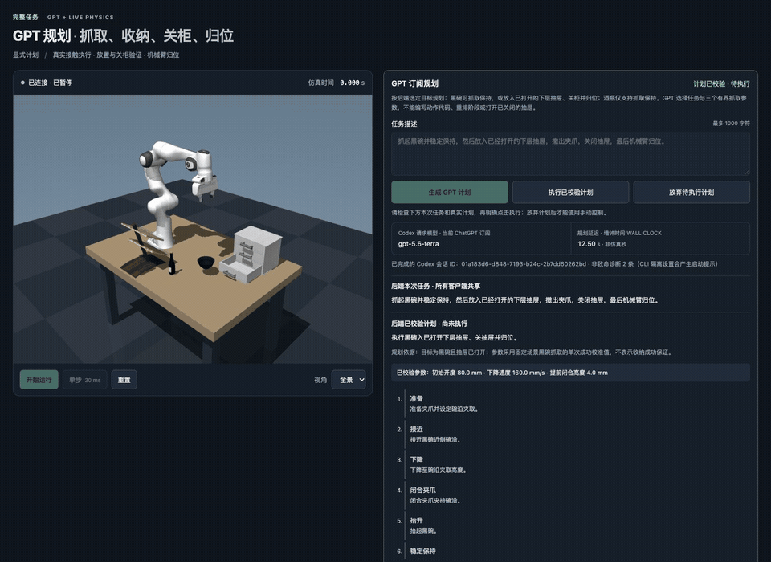

# GPT — 机器人多子任务执行仿真

为 GPT 高层任务规划提供可调用的机器人执行能力。现有物理场景、固定脚本 baseline、参数化抓取与时序控制，以及第四阶段的订阅规划、计划预览和本地执行衔接。**已通过官方 Codex CLI 使用当前 ChatGPT 订阅，实际完成模型规划 → 本地校验 → MuJoCo 物理抓取**；不需要 API 密钥，没有用固定回复冒充 GPT。尚未加入视觉识别或 DP。

仓库：https://github.com/youseihuayu-wonderful/GPT

场景包含 Franka Panda 七轴机械臂、双指夹爪、桌面、黑碗、酒瓶、三层抽屉柜、酒架。浏览器画面由正在运行的 MuJoCo Renderer 生成，不是视频或预录轨迹回放。物体位姿直接取自仿真器。

实施顺序：

1. 搭建仿真场景：已完成，读取物体真值位姿。
2. 固定脚本抓取：已完成，保留顺序执行 baseline。
3. 参数化抓取与时序控制：已完成，支持真实运动重叠及固定场景参数小实验。
4. GPT 规划层：已完成当前黑碗抓取能力内的真实订阅联调与右侧物理演示。
5. 跨物体、位置与方法的对比实验：尚未开展；当前参数小实验不等于这一阶段。

## 动态 Demo

[](media/grasp-demo.mp4)

[查看或下载完整高清 MP4](media/grasp-demo.mp4)

上图是**真实浏览器仿真录屏的循环 GIF**，不是静态截图，也不是在 GitHub 服务器上运行 MuJoCo。GIF 从完整录像第 10 秒开始，保留整个抓取执行过程，按原速以 12 fps 循环播放；MP4 还包含通过当前 ChatGPT 订阅生成计划、预览和点击执行的过程。本地实时交互方式见下一节。

该次录制使用 `gpt-5.6-terra` 生成的 80/200/4 参数；从重置场景完成抓取耗时 11.684 s（仿真时间），抬升约 0.1376 m，成功后继续保持超过 5 s，无 MuJoCo 数值警告。它是另一次单场景演示，与 `results/subscription_grasp.json` 中先前的实测记录分开，不代表跨场景成功率。


## 启动与右侧显示

先克隆仓库，再安装锁定的依赖（需要 Python 3.12 和 [uv](https://docs.astral.sh/uv/)）：

```sh
git clone https://github.com/youseihuayu-wonderful/GPT.git
cd GPT
uv sync --locked
uv run python server.py --port 8765
```

服务仅监听 `127.0.0.1`。另一个终端中执行：

```sh
terminal-browser open http://127.0.0.1:8765 --split right --size 0.48
```

也可以直接在浏览器打开 http://127.0.0.1:8765 。服务停止后重新执行启动命令，再点击页面的“重新连接”。物理仿真与手动 baseline 不依赖外部模型或 GPU 服务；GPT 规划需要下述 Codex CLI 与有效的 ChatGPT 订阅登录。

- 运行固定 baseline：以 80 mm 开口、100 mm/s 名义下降速度、0 mm 提前闭合执行。技能执行期间不能重复启动；成功或失败后需先重置。
- 运行自定义参数：校验并使用三个输入值，自动开始物理积分。编辑输入框不会改变正在执行的参数；“实际应用”显示后端采用的配置。
- 实验表中的“填入参数”只填表，不启动或重置；“刷新报告”读取最新保存的真实实验结果。
- 暂停／开始运行：停止／继续物理积分。
- 单步：暂停时推进 20 ms，即 10 个 2 ms 物理步。
- 重置：取消未完成的规划、作废旧计划，恢复物理初态、后端默认参数并清空计时，暂停仿真；页面输入值保留，便于再次执行同一配置。
- 视角：全景、正面、俯视。
- 没有浏览器连接时不推进物理；多个页面共享同一个仿真实例与控制状态。
- 画面目标更新频率为 20 Hz。显示的是仿真时间，不是宿主机墙钟时间；机器负载可能降低实际播放速度。

## 第四阶段：GPT 受限规划

当前只支持“夹取黑碗碗沿、抬起并稳定保持”。GPT 根据自然语言任务、仿真真值和已存储参数实验，选择三个有界抓取参数，并说明 `prepare → approach → descend → close → lift → hold` 六个固定控制器阶段。**这是受限高层规划／参数选择，不是任意任务排序或开放式机器人代理**。下降与闭合仍可根据触发高度重叠。

放置、松手、抓酒瓶、放入抽屉、关闭抽屉等均未开放；提示词要求对包含未实现动作的整项任务返回 `unsupported`，不能偷偷只执行抓碗部分。模型可能误解自然语言，必须检查预览；本地校验能保证动作白名单和参数边界，不能证明模型正确理解了每个用户意图，也不保证物理抓取成功。

### 使用现有 ChatGPT 订阅

采用官方 [Codex 认证](https://developers.openai.com/codex/auth/)与[非交互执行](https://developers.openai.com/codex/noninteractive/)，复用本机已有的 ChatGPT 登录。本轮实际验证版本为 `codex-cli 0.164.0`。新机器先安装官方 CLI，并选择 ChatGPT 订阅登录：

```sh
npm install -g @openai/codex
codex login
codex login status
```

已登录的机器不需要重新登录。应用在每次规划前运行 `codex login status`，只接受 ChatGPT 登录；API-key 登录、未登录、额度不足或模型不可用都明确失败，不改用 API 付费。应用不读取、复制或上传 Codex 的认证文件。

默认请求模型为 `gpt-5.6-terra`，已用本机订阅实测。不同账号的模型权限可能不同；模型目录缓存只是候选信息，不保证调用成功。可选的本机 `.env` 只设置 `CODEX_MODEL`，同名环境变量优先，每次生成重新读取。配置示例见 `.env.example`；实际 `.env` 不入库。

规划通过 `codex exec --json --output-schema` 执行，使用独立临时目录、只读沙箱、临时会话与严格配置。关闭 shell、浏览器、应用、插件、MCP、子代理等能力，不加载项目说明或本机技能目录；忽略用户自定义 CLI 配置，但保留官方登录方式。应用传入任务文本、仿真状态、参数实验记录和规划约束，不主动加入图像或 PDF。

登录检查超时为 10 s，规划进程超时为 90 s。超时或取消会终止本地进程组；进程不响应终止信号时强制停止。应用没有自动重试或模型降级；CLI 自身可能进行有限的网络重连，仍受进程超时约束。`--ephemeral` 不保存本次 CLI 会话历史，不代表服务商端零数据保留。

该版本 CLI 对实验性技能隔离、被禁用的 Code Mode 各产生一条非致命诊断。页面保留诊断数量，不输出可能包含本机信息的原始消息。只有完整的 `turn.completed` 和有效计划才能执行；致命错误、失败回合或任何非规划工具事件仍被拒绝。

### 操作与安全边界

1. 重置场景，在任务框填写黑碗抓取与保持的要求，点击“生成 GPT 计划”。只请求规划，不自动运动；CLI 或订阅登录不可用时明确报错，不生成替代计划。
2. 查看本次任务、模型实际回复、参数和子阶段，再点击“执行已校验计划”。模型生成的文本只作显示；执行端只使用已校验的参数，不运行模型代码或任意指令。
3. 实际阶段、接触、抬升与保持决定成功或失败。GPT 文字不能设置成功标志；成功后的失抓也会撤销规划器的成功状态。

规划中和待执行时冻结场景，禁止手动开始、单步或另起抓取；仍可暂停、换视角、取消规划或重置。“取消规划”只取消请求或丢弃待执行计划，已开始的物理动作使用暂停／重置。取消本地请求不能保证恢复已经消耗的订阅额度。

每个计划绑定一个代次标识。取消、重置会使旧标识失效；即使旧请求后来返回，也不能恢复旧计划。执行只接受当前 `ready` 计划，不能重复消费；多个页面共享计划和仿真。断线后显示最后状态并禁用执行，重连不会自动重新规划或启动动作。

模型计划必须字段齐全、目标为黑碗、六阶段完整且顺序正确，参数通过 `GraspParameters` 同一套边界。缺项、额外动作、重排、非法目标、布尔值、非有限数值、越界参数、重复 JSON 键、拒答、截断响应及接口错误均不会产生可执行计划；不悄悄补默认值、裁剪或使用固定答案兜底。

### WebSocket 与状态

`/ws` 新增命令：

- `{"action":"plan","task":"抓起黑碗并稳定保持，优先减少耗时。"}`：物理技能必须 idle，且没有正在生成或等待执行的计划。
- `execute_plan`：携带当前 `state.planner.plan_id`，执行后端保存的计划；不从客户端接收替换计划或参数。
- `{"action":"cancel_plan"}`：取消规划或放弃待执行计划。

`/api/state` 和实时消息包含 `planner`：`status`、`configured`、`model`、`task`、`plan_id`、`plan`、`latency_s`、`thread_id`、`diagnostic_count`、`error`。`configured` 仅表示找到 Codex CLI，不等于认证成功。计划中含 `decision / summary / reason / target_object / steps / parameters`；不支持时目标和参数为 null，步骤为空。

`latency_s` 是登录检查与规划的墙钟耗时；`skill.elapsed_s` 是物理仿真时间，两者不能直接相加当作端到端墙钟时间。`model` 明确表示请求型号，不冒充服务端返回的模型快照；`thread_id` 仅在真实完成并校验后提供。此阶段没有开展 GPT 与规则方法的性能比较。

## 位姿接口

```sh
curl http://127.0.0.1:8765/api/state
uv run python simulation.py --seconds 10 --image /tmp/grasp-scene.jpg
```

Python 可直接使用：

```python
from simulation import Simulation

sim = Simulation()
try:
    sim.step(1.0)
    print(sim.get_object_pose("bowl_object"))
finally:
    sim.close()
```

可观测对象：`bowl_object`、`bottle_object`、`cabinet_cabinet_bottom`。`position_m` 为世界坐标中的刚体参考原点，单位米；`quaternion_wxyz` 顺序为 **w,x,y,z**。它们来自 `MjData.xpos/xquat`，不是视觉估计，也不一定是质心或物体表面的高度。每次积分后调用 `mj_forward`，保证位姿与当前积分状态一致。

## 抓取技能接口与判定

界面点击“运行固定 baseline”，或无界面执行：

```sh
uv run python simulation.py --grasp --image /tmp/grasp-result.jpg
uv run python -m unittest discover -s tests -p 'test_grasp.py' -v
```

`--grasp` 默认先运行 1 s 场景稳定过程，再执行完整技能；失败时退出码为 1。渲染图为真实终态，不是成功示意图。

Python 调用 `sim.start_grasp()` 后持续调用 `sim.step(0.02)`，通过 `sim.state()["skill"]` 读取 `idle / running / succeeded / failed` 状态。WebSocket `/ws` 接收 `{"action":"grasp"}`，HTTP `/api/state` 同样返回技能状态。只有 idle 可以启动；重置取消任务、清空计时并恢复物理初态。

执行阶段：等待桌面稳定并设置初始开口、接近、下降、闭合、抬升、保持。默认 baseline 保持顺序执行，没有人为插入停顿；非零触发高度允许下降中开始闭合，但仍须确认下降到位和双侧接触后才抬升。

- 碗碰撞外径约 107 mm，大于夹爪约 80 mm 的开口，因此夹持近侧碗沿：一指在碗内，一指在碗外。没有修改碗的尺寸、壁厚、质量、摩擦或碰撞网格。
- 机械臂用数值逆运动学、五次平滑关节插值和偏置力前馈，仍通过原位置执行器及其力限制运动。不是通用避障规划器。
- 夹爪保留原关节、腱和 ±100 N 执行器力限制，改用腱力输入：打开时为位置 PD，闭合时为 4 N 腱闭合力，并附加与速度成正比的阻尼；力由腱分配至两指。这避免薄碗沿处零开口位置伺服的夹持力随误差缩小而不足；没有向碗直接施加控制力。
- 场景设置 `noslip_iterations="5"`，使用 MuJoCo 的[摩擦防漂移后处理](https://mujoco.readthedocs.io/en/3.3.7/XMLreference.html#option-noslip-iterations)，抑制软接触模型产生的持续数值滑移。没有增加材质摩擦系数，也没有添加物体绑定或焊接约束。
- 成功要求：相对准备阶段的稳定碗位抬升至少 0.10 m、两指均有实际接触力、没有桌面支撑，并保持 1 s；保持期间碗与夹爪相对位置漂移不得超过 0.01 m。
- 不可达、到位超时、未建立双侧接触、抬升丢失接触或保持失败均返回 failed；首次完成前的执行有 20 s 仿真时间上限。成功后继续监测持物状态，后续掉落或滑移会改报 failed，而不是保留过期的成功状态。失败不自动重试。
- 页面记录总执行时间、各阶段时间、实际抬升高度和保持时间；暂停冻结物理与这些计时。执行时间从调用技能起计，不包含 CLI 的初始场景稳定过程；若完成后失去夹持，失败时间记录至检测时刻。

这是固定工位下的一个可调用抓取技能，不等于完整的 GPT 多子任务规划系统，也尚未实现放入抽屉和关闭抽屉。

## 第三阶段：参数与重叠控制

`GraspParameters` 是不可变的已校验配置；Python／WebSocket 使用 SI 单位，界面和命令行使用 mm、mm/s：

| 字段 | 含义 | 界面允许范围 | 默认值 |
| --- | --- | --- | --- |
| `initial_opening_m` | 初始总开度，两个夹指滑动关节位移之和 | 20–80 mm | 80 mm |
| `descent_speed_m_s` | 用于计算下降轨迹时长的名义速度 | 40–200 mm/s | 100 mm/s |
| `close_trigger_height_m` | TCP 距下降目标的剩余高度，达到后触发闭合 | 0–20 mm | 0 mm |

下降采用五次平滑关节轨迹，速度设置还受关节轨迹速率和最短运动时长约束，**不是 TCP 恒速控制或实测速度保证**。触发高度相对下降目标，不是相对桌面或碗顶；非零值还要求 TCP 横向误差小于 4 mm。0 保持“确认下降完成后闭合”。允许范围不意味着每个配置都能成功。

在已有 `sim` 实例上使用：

```python
from grasp import GraspParameters

sim.start_grasp(GraspParameters(
    initial_opening_m=0.08,
    descent_speed_m_s=0.20,
    close_trigger_height_m=0.004,
))
```

WebSocket 请求：

```json
{"action":"grasp","parameters":{"initial_opening_m":0.08,"descent_speed_m_s":0.20,"close_trigger_height_m":0.004}}
```

省略 `parameters` 仍运行 baseline。非数值、布尔值、NaN、无穷值、越界数值和未知参数在启动前拒绝，不悄悄裁剪或替换默认值。`/api/state` 中的 `skill.parameter_limits` 提供同一套边界，界面不另设范围。

命令行复现同一重置初态：

```sh
uv run python simulation.py --seconds 0 --grasp \
  --initial-opening-mm 80 --descent-speed-mm-s 200 \
  --close-trigger-height-mm 4 --image /tmp/parameter-grasp.jpg
```

三个参数选项均要求 `--grasp`。`--seconds 0` 让技能自身完成准备阶段，与页面重置后运行及参数实验一致；不指定时仍保留原 CLI 的 1 s 预稳定过程。

新增技能状态：

- `parameters`：本次实际应用的参数，不使用页面输入值冒充。
- `close_started_s`、`descent_completed_s`：闭合指令开始、反馈确认下降完成的时刻，均相对任务起点；未发生时为 `null`。闭合开始不等于接触已经建立。
- `descent_close_overlap_s`：下降阶段内，实际 TCP 向下速度与两指总闭合速度均超过 `0.0001 m/s` 时，累计对应物理步长。不是两条指令时间差，也不把静止夹紧计作运动；暂停时不累加。

## 固定场景参数小实验

```sh
uv run python experiments.py --output results/parameter_sweep.json
```

每组创建独立仿真，从相同重置初态启动，不使用重试；首次成功后额外推进 5 s 检查持续夹持。失败按实际结果记录；求解异常会停止实验并报错，不伪造成功数据。报告完整写入后才替换旧文件。页面 `/api/experiments` 读取该报告，缺失或损坏会明确报错。

已实际运行的结果（全部时间为仿真秒）：

| 配置 | 开口 mm | 名义下降速度 mm/s | 提前闭合 mm | 执行时间 s | 实际运动重叠 s | 结果 |
| --- | ---: | ---: | ---: | ---: | ---: | --- |
| baseline | 80 | 100 | 0 | 13.272 | 0.000 | 成功 |
| smaller_opening | 50 | 100 | 0 | 13.318 | 0.000 | 成功 |
| faster_descent | 80 | 160 | 0 | 12.146 | 0.000 | 成功 |
| overlap | 80 | 100 | 4 | 13.140 | 0.144 | 成功 |
| fast_overlap | 80 | 160 | 4 | 12.012 | 0.142 | 成功 |
| higher_speed_overlap | 80 | 200 | 4 | 11.684 | 0.084 | 成功 |
| combined | 50 | 160 | 4 | 12.102 | 0.096 | 成功 |
| early_closure | 50 | 160 | 20 | 12.100 | 0.160 | 成功 |

表中最短配置比 baseline 减少约 12% 执行时间；不是全局最优结论。缩小开口不必然更快：准备阶段调节开口也需要时间。提前 20 mm 的终态抬升约 12.25 cm，低于提前 4 mm 组合的约 13.68 cm，不能仅按闭合越早越好来选参数。

以上每组仅在一个固定场景运行一次，无位置扰动；不能据此声称统计成功率、跨场景性能或 GPT 优于规则。保存的实验表与正在运行的任务独立；可填入某行参数，再重置并运行以观看真实执行。


## 物理与场景范围

- 重力 `-9.81 m/s²`，步长 `0.002 s`，`implicitfast` 积分。
- 重置时机械臂保持初始姿态、夹爪打开；启动技能后由本地反馈控制器执行抓取、抬升和保持。没有直接设置碗的跟随轨迹或约束绑定。
- 黑碗、酒瓶使用自由关节和原资产碰撞几何，受重力和桌面接触支撑。没有绑定到机械臂。
- 抽屉柜和酒架是固定工位设施；保留柜子三个滑动抽屉关节，底层抽屉初始位移 `-0.12 m`。
- 桌面高度 `0.72 m`，台面 `1.30 × 0.90 m`。物体在重置后会短暂下落并在桌上稳定。
- 原视频对应 LIBERO-10 的 `KITCHEN_SCENE4_put_the_black_bowl_in_the_bottom_drawer_of_the_cabinet_and_close_it`。本项目复用同款物体资产、采用 Menagerie Panda，在独立桌面上重新布置；**不是原 LIBERO 任务初始状态、控制器、轨迹或 benchmark 的复现**。
- 原视频用碰撞几何进行软件绘制，本项目用原模型的视觉网格渲染，因此外观有所不同。黑碗材质调暗以便识别，碰撞几何没有改动。

## 文件与来源

- `scene.xml`：桌面、灯光和机械臂／物体安装坐标。
- `simulation.py`：模型组合、物理积分、重置、位姿读取、渲染及命令行入口。
- `grasp.py`：不可变参数配置、抓取状态机、数值逆运动学、执行器控制、运动重叠测量及成功／失败检查。
- `tests/test_grasp.py`：不依赖图像或 mock 的真实物理行为检查。
- `planner.py`：官方 Codex 订阅客户端、子进程生命周期、结构化计划协议与安全校验。
- `planning.py`：异步请求、取消／重置代次隔离、计划消费和物理结果衔接。
- `tests/test_planner.py`、`tests/test_planning.py`：计划边界、错误、取消竞争与物理结果同步检查；受控回复只用于测试，不是 GPT 证据。
- `.env.example`：不含密钥的本机配置示例；实际 `.env` 不入库。
- `experiments.py`：独立真实物理参数对照入口。
- `results/parameter_sweep.json`：已执行的八组原始测量报告，不是手工填充数据。
- `results/subscription_grasp.json`：真实订阅请求、预览互锁、物理阶段及成功后保持的实测记录，不含认证信息或模型思考内容。
- `server.py`：本地 HTTP／WebSocket 服务。
- `web/`：中文预览界面。
- `vendor/panda/`：[MuJoCo Menagerie](https://github.com/google-deepmind/mujoco_menagerie/tree/da76818e269b82289eba39808e2fb91d679d6994/franka_emika_panda)，提交 `da76818e269b82289eba39808e2fb91d679d6994`，保留 Apache-2.0 LICENSE。
- `vendor/libero/`：[LIBERO](https://github.com/Lifelong-Robot-Learning/LIBERO/tree/8f1084e3132a39270c3a13ebe37270a43ece2a01/libero/libero/assets)，提交 `8f1084e3132a39270c3a13ebe37270a43ece2a01`，保留上游 MIT LICENSE。资源从本机现有研究工程复制，原工程未修改。

## 已执行的物理验证

场景阶段曾独立运行 20 s，验证重力接触稳定、归一化位姿、精确重置与 20 ms 单步。抓取阶段实际 CLI 运行成功：技能耗时约 13.074 s，碗抬升约 0.1392 m，并稳定保持 1 s；无 MuJoCo 数值警告。上述数字只代表当前固定场景，不是成功率、提速或真实硬件性能结论。

9 项行为检查通过，覆盖真实抓起并持续保持、保持途中重置再执行、重复启动拒绝、夹爪失效及成功后掉落、实际初始开口、下降／闭合同时运动与更短耗时、无效参数拒绝和拒绝后的状态不变。baseline、重置重跑及 50/160/4 组合均在成功后继续推进 60 s，检查物理持物而不只看成功标志。此前 baseline 还单独验证了成功后继续仿真 120 s 不掉落。

浏览器实际验证了非法输入阻止执行、从真实实验报告填入参数、按自定义配置运行、下降阶段触发闭合时暂停，以及暂停中切换视角后恢复执行。50/160/4 配置的实际执行时间约 12.102 s，运动重叠 0.096 s；暂停期间物理时间和重叠计时均不变化。无浏览器脚本错误。HTTP／WebSocket 另验证了六类无效参数请求均保持物理状态为暂停且时间为零。

## 第四阶段验证范围

运行全部行为检查：

```sh
uv run python -m unittest discover -s tests -v
```

本轮全部 38 项检查通过，覆盖真实物理行为、计划边界、配置安全、API-key 登录拒绝、不完整／失败／工具调用事件拒绝、取消／重置后迟到回复、过期／重复执行拒绝，以及成功后失抓对规划状态的更新。还实际启动带子进程的进程组，验证超时、取消和强制终止不会留下执行进程；验证 API 计费凭证不会传入规划子进程。

真实模型验证：当前 ChatGPT 订阅通过 Codex 请求 `gpt-5.6-terra`，返回六阶段计划与 80/200/4 参数；另一条真实 CLI 请求“把黑碗放进抽屉，然后关闭抽屉”返回 `unsupported`、空步骤和空参数。不是受控回复或固定预设。

右侧正式服务完成实际浏览器流程：点击生成后，物理保持 idle 且暂停，页面显示真实计划，手动启动被锁定；明确点击执行后，依次观察到六阶段及完成状态。该次规划耗时 6.142 s（墙钟），抓取耗时 11.486 s（仿真），抬升约 0.13746 m，稳定保持判定 1 s；成功后额外推进约 5.05 s，仍持物且无 MuJoCo 数值警告。实际下降／闭合重叠为 0.084 s。完整记录见 `results/subscription_grasp.json`。

右侧保留实际渲染的成功抓取画面并暂停，仍可恢复物理积分；重新演示需重置、生成新计划并明确执行。当前浏览器缩放下无横向溢出。此前已验证断线禁用、重连不自动重复请求、HTML 仅按文本显示等页面边界。

**范围限制：一次固定场景的真实订阅联调，不是成功率、跨场景泛化或 GPT 优于规则控制的证据。** 本次执行前桌面已静置，不能把本轮耗时与参数扫描结果直接相减作为提速结论；第五阶段对比实验仍未开展。
