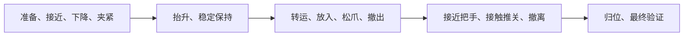

# GPT — 机器人多子任务执行仿真

为 GPT 高层任务规划提供真实物理执行能力。现在支持**抓起黑碗并保持 → 放入已打开的下层抽屉 → 接触推关抽屉 → 机械臂归位**，也保留黑碗／酒瓶的单独抓取对照。已通过官方 Codex CLI 使用当前 ChatGPT 订阅，实际完成结构化规划、显式执行和 MuJoCo 完整收纳验证；不需要 API 密钥，没有固定回复、物体绑定或动画平移。尚未加入视觉识别或 DP。

仓库：https://github.com/youseihuayu-wonderful/GPT

场景包含 Franka Panda 七轴机械臂、双指夹爪、桌面、黑碗、酒瓶、三层抽屉柜、酒架。浏览器画面由正在运行的 MuJoCo Renderer 生成，不是视频或预录轨迹回放。物体位姿直接取自仿真器。

实施顺序：

1. 搭建仿真场景：已完成，读取物体真值位姿。
2. 固定脚本抓取：已完成，保留顺序执行 baseline。
3. 参数化抓取与时序控制：已完成，支持真实运动重叠及固定场景参数小实验。
4. GPT 规划层：已接入单独抓取与完整黑碗收纳两种受限任务，并完成真实订阅、右侧界面和物理执行联调。
5. 跨物体、位置与方法的对比实验：已完成 54 次配对抓取运行，其中 18 次使用真实 GPT 订阅请求；结果与限制见下文。

本次新增的是**五项独立本地技能**：可在同一仿真中逐项调用、物理验收并交接，无需重置。原有固定任务复用同一套控制路径；GPT 仍只选择原有两种固定任务及参数，尚未升级为自由组合技能的规划器。

## 动态 Demo

[](media/grasp-demo.mp4)

[查看或下载完整高清 MP4](media/grasp-demo.mp4)

上图是**真实浏览器仿真录屏的循环 GIF**，不是静态截图，也不是在 GitHub 服务器上运行 MuJoCo。MP4 长 88.95 s（1440 × 1050，20 fps），包含订阅生成计划、预览和完整收纳；GIF 从第 14 秒开始，以 960 × 700、8 fps 保留整个物理执行过程并循环播放。两者均按墙钟原速播放，仿真秒与视频秒不是同一个时钟。

完整执行与终态证据见 [`results/subscription_storage.json`](results/subscription_storage.json)。成功必须同时满足碗完全位于抽屉内、底面支撑、夹爪脱离、抽屉关闭和机械臂归位；模型文字与“已经抬起”均不能设置完整任务成功。该演示不代表跨场景成功率或 GPT 优于固定规则。


## 启动与右侧显示

先克隆仓库，再安装锁定的依赖（需要 Python 3.12 和 [uv](https://docs.astral.sh/uv/)）：

```sh
git clone https://github.com/youseihuayu-wonderful/GPT.git
cd GPT
uv sync --locked
uv run python server.py --port 8765
```

服务仅监听 `127.0.0.1`。另一个终端中执行：

```sh
terminal-browser open http://127.0.0.1:8765 --split right --size 0.48
```

也可以直接在浏览器打开 http://127.0.0.1:8765 。服务停止后重新执行启动命令，再点击页面的“重新连接”。物理仿真与手动 baseline 不依赖外部模型或 GPU 服务；GPT 规划需要下述 Codex CLI 与有效的 ChatGPT 订阅登录。

- 运行固定 baseline：以 80 mm 开口、100 mm/s 名义下降速度、0 mm 提前闭合执行。运行中不能重复启动；固定任务再次运行需重置。
- 运行自定义参数：校验并使用三个输入值，自动开始物理积分。编辑输入框不会改变正在执行的参数；“实际应用”显示后端采用的配置。
- 运行完整固定任务：不用 GPT，以 baseline 抓取参数执行收纳、关柜和归位；不是失败后的自动兜底。
- 实验表中的“填入参数”只填表，不启动或重置；“刷新报告”读取最新保存的真实实验结果。
- 独立本地技能：从列表选择技能，查看实时前置条件与完成判据，再单次启动。只有抓取技能使用参数输入框；成功后可选择下一项，不自动串联、不调用 GPT。失败后必须重置。
- 暂停／开始运行：停止／继续物理积分。
- 单步：暂停时推进 20 ms，即 10 个 2 ms 物理步。
- 重置：取消未完成的规划、作废旧计划，恢复物理初态、后端默认参数并清空计时，暂停仿真；页面输入值保留，便于再次执行同一配置。
- 视角：全景、正面、俯视。
- 没有浏览器连接时不推进物理；多个页面共享同一个仿真实例与控制状态。
- 画面目标更新频率为 20 Hz。显示的是仿真时间，不是宿主机墙钟时间；机器负载可能降低实际播放速度。

## 五项独立技能：本次第 1 步

对应会议纪要第 3、5 页的“先确认控制接口与动作协调能力”，以及第 4 页的仿真合理性检查。第 6 页的状态／动作／时间戳保存属于整理者补充建议，本项目采用该建议形成验收记录，不将其冒充已定稿的算法或 benchmark。

| 技能 | 必须具备的起始条件 | 完成后留下的状态 |
| --- | --- | --- |
| `grasp_and_hold` | 空夹爪在支持的高位；选定黑碗／酒瓶在桌面稳定 | 实际抬升、双侧夹持并保持；不自动放置 |
| `place_and_release` | 已验证稳定持有黑碗；抽屉全开且原尺寸适合通道 | 碗完整入屉、真实支撑、已松爪且稳定；手仍在抽屉内 |
| `withdraw_from_drawer` | 碗支撑、静稳、脱离；手位于支持的放置交接区域 | 手部退出抽屉运动区域并到达高位；不自动推关 |
| `close_drawer` | 抽屉全开、无物体阻挡；空夹爪在已验证高位 | 通过真实把手接触关闭抽屉并撤离；不自动归位，也不要求碗必须先入屉 |
| `return_home` | 空夹爪已撤离并处于已验证高位回程区域 | 关节位姿和速度满足 home 判据；不改变抽屉目标 |

原资产、物体尺寸、质量、摩擦和执行器限制保持不变。独立关空抽屉时，原中心接触路径会让手掌碰到仍在桌面的碗；现在统一使用测得把手右端以内 14 mm 的接触点，而不是移走碗或屏蔽接触。检查抽屉关闭通道时按原碰撞分件计算扫掠区域，避免把把手旁的空隙错误填成实体。

启动推关前还用实际手掌／手指碰撞包围盒检查固定接近与推动路径，预留 10 mm 跟踪余量；发现桌面物体挡路就拒绝启动，不尝试绕行。执行中仍检查真实意外接触，几何预检查不代替接触检测。

### 调用与状态边界

- Python：`sim.start_skill(name, parameters=None)`，随后用 `sim.step(0.02)` 推进。只有 `grasp_and_hold` 接受 `GraspParameters`；其他技能传参会被拒绝。
- WebSocket：例如 `{"action":"skill","skill":"close_drawer"}`。GPT 规划／待执行计划仍锁住手动入口；已接受的手动调用清除旧 GPT 归因，不重置物理场景。
- `available_skills` 给出契约、实时可用性及拒绝原因。启动时重新检查，不信任页面按钮或上一帧状态。
- `skill.execution_mode` 区分 `task` 和 `skill`；`skill.skill_name` 是实际当前技能；`invocation_id` 仅在接受公开调用时递增。
- `skill.postconditions` 是实际物理检查。`gripper_clear` 表示与碗脱离，**不等于** `hand_clear_of_drawer`；后者检查手掌／手指碰撞包围盒是否离开抽屉运动区域。
- 已接受的 API 调用本身不改 `qpos/qvel/ctrl/time`；运动发生在后续物理积分。运行中禁止插入另一技能；拒绝不改变当前执行或碰撞记录。失败后不能继续调用。
- 成功后保持执行器控制并继续检查物理条件；抓取后不松爪。后续扰动可撤销成功，不能保留过期的绿色状态。各独立调用之间保留碰撞记录。
- 数值异常在物理步前后检查并锁存，必须重置才能恢复；清掉单个警告不能继续旧轨迹。网页运行线程或单步执行遇到致命异常时停止，WebSocket 明确报告“需重启服务”，`/api/state` 返回 503，不继续读取可能损坏的物理状态。

### 可直接复现的验收

不抓碗，直接关空抽屉并归位：

```sh
uv run python simulation.py --skill close_drawer return_home
```

同一仿真内五次独立调用，使用已验证的下降／闭合重叠参数：

```sh
uv run python simulation.py --skill grasp_and_hold place_and_release \
  withdraw_from_drawer close_drawer return_home \
  --initial-opening-mm 80 --descent-speed-mm-s 200 --close-trigger-height-mm 4
```

保存完整物理验收记录：

```sh
uv run python verify_skills.py --output results/skills_verification.json
```

[`results/skills_verification.json`](results/skills_verification.json) 保存场景／种子、每次请求及拒绝原因、调用前后的完整 `qpos/qvel/ctrl/time`、实际接触力、控制量、阶段时间及模型指纹。API 边界逐值核对；物理观察间隔为 20 ms，轨迹每 100 ms 或阶段变化采样。模型完整哈希在边界核对，物理参数逐观察步核对；这些记录不是每个内部求解操作的审计。

已执行的三个无重置正向场景：

| 场景 | 总仿真时间（含预稳定和额外保持） | 意外碰撞 |
| --- | ---: | ---: |
| 独立关空抽屉、归位，碗始终留在桌面 | 45.380 s | 0 |
| 五技能衔接，80/100/0 | 77.160 s | 0 |
| 五技能衔接，80/200/4 | 75.540 s | 0 |

每个中间交接额外推进 1 s，末尾推进 5 s；基线下降／闭合重叠为 0，快速配置实际重叠 0.084 s。报告还包含 33 次拒绝检查，以及单独标记的 20 N 外力失抓检查：后者的预期结果是撤销成功并禁止继续调用，不是“抗住扰动”。报告 `passed` 表示通过相应验收，不表示每项请求都执行成功。

范围限于确定性的固定工位；关屉暂只支持全开抽屉，放置／撤离只支持黑碗，关闭与归位要求空夹爪和 TCP 至少 1.03 m 的已验证高位。不自动开抽屉，不提供通用避障、任意中间姿态恢复或 GPT 技能组合。上述小样本不是成功率估计，也不是新规划算法或跨场景性能比较。

## 第四阶段：GPT 受限规划

GPT 根据自然语言任务、当前选定目标的仿真真值和原始参数校准记录，选择任务种类与三个有界抓取参数，生成对应的完整固定阶段说明。**这是受限高层规划／参数选择，不是任意任务排序或开放式机器人代理**；底层位置、力、闭合时机及成功判据仍由本地控制器决定。

| `task_kind` | 可选目标 | 完成目标 |
| --- | --- | --- |
| `grasp` | `bowl`、`bottle` | 夹取碗沿或瓶颈，抬升并稳定保持 |
| `store_bowl` | 仅 `bowl` | 抓取保持、入屉、松爪撤离、接触推关、归位并验证 |

`server.py --target bottle` 选择酒瓶抓取场景，默认目标是黑碗；GPT 不能自行切换目标。打开已关闭的抽屉、把酒瓶放入抽屉、倾倒或操纵其他物体不受支持。包含缺失动作的整项请求必须返回 `unsupported`，不能偷偷执行子集。模型仍可能误解自然语言，必须检查预览；本地校验保证动作白名单和参数边界，不证明每个意图都被正确理解，也不保证每组参数都能物理成功。

### 使用现有 ChatGPT 订阅

采用官方 [Codex 认证](https://developers.openai.com/codex/auth/)与[非交互执行](https://developers.openai.com/codex/noninteractive/)，复用本机已有的 ChatGPT 登录。本轮实际验证版本为 `codex-cli 0.164.0`。新机器先安装官方 CLI，并选择 ChatGPT 订阅登录：

```sh
npm install -g @openai/codex
codex login
codex login status
```

已登录的机器不需要重新登录。应用在每次规划前运行 `codex login status`，只接受 ChatGPT 登录；API-key 登录、未登录、额度不足或模型不可用都明确失败，不改用 API 付费。应用不读取、复制或上传 Codex 的认证文件。

默认请求模型为 `gpt-5.6-terra`，已用本机订阅实测。不同账号的模型权限可能不同；模型目录缓存只是候选信息，不保证调用成功。可选的本机 `.env` 只设置 `CODEX_MODEL`，同名环境变量优先，每次生成重新读取。配置示例见 `.env.example`；实际 `.env` 不入库。

规划通过 `codex exec --json --output-schema` 执行，使用独立临时目录、只读沙箱、临时会话与严格配置。关闭 shell、浏览器、应用、插件、MCP、子代理等能力，不加载项目说明或本机技能目录；忽略用户自定义 CLI 配置，但保留官方登录方式。应用传入任务文本、仿真状态、参数实验记录和规划约束，不主动加入图像或 PDF。

登录检查超时为 10 s，规划进程超时为 90 s。超时或取消会终止本地进程组；进程不响应终止信号时强制停止。应用没有自动重试或模型降级；CLI 自身可能进行有限的网络重连，仍受进程超时约束。`--ephemeral` 不保存本次 CLI 会话历史，不代表服务商端零数据保留。

该版本 CLI 对实验性技能隔离、被禁用的 Code Mode 各产生一条非致命诊断。页面保留诊断数量，不输出可能包含本机信息的原始消息。只有完整的 `turn.completed` 和有效计划才能执行；致命错误、失败回合或任何非规划工具事件仍被拒绝。

### 操作与安全边界

1. 重置场景，填写任务并点击“生成 GPT 计划”。默认任务是黑碗入屉、关柜和归位。生成只请求规划，不自动运动；CLI 或订阅登录不可用时明确报错。
2. 检查任务种类、完整子阶段和参数，再点击“执行已校验计划”。执行端只使用已校验的任务与参数，不运行模型代码或任意指令。
3. 实际物理状态决定成败。完整收纳不能在初始抓取保持时报告成功；成功后若碗、抽屉或机械臂状态失效，也会撤销成功。

规划中和待执行时冻结场景，禁止手动开始、单步或另起抓取；仍可暂停、换视角、取消规划或重置。“取消规划”只取消请求或丢弃待执行计划，已开始的物理动作使用暂停／重置。取消本地请求不能保证恢复已经消耗的订阅额度。

每个计划绑定一个代次标识。取消、重置会使旧标识失效；即使旧请求后来返回，也不能恢复旧计划。执行只接受当前 `ready` 计划，不能重复消费；多个页面共享计划和仿真。断线后显示最后状态并禁用执行，重连不会自动重新规划或启动动作。

模型计划必须包含 `task_kind`，目标与当前场景一致，阶段严格等于该任务的 `TASKS` 顺序，参数通过 `GraspParameters` 和任务附加边界。收纳任务的初始开度至少为 60 mm。缺项、额外动作、重排、非法目标、布尔值、非有限数值、越界参数、重复 JSON 键、拒答、截断响应及接口错误均不能产生可执行计划；不补默认任务、不裁剪、不用固定答案兜底。

### WebSocket 与状态

`/ws` 新增命令：

- `{"action":"plan","task":"抓起黑碗并稳定保持，优先减少耗时。"}`：物理技能必须 idle，且没有正在生成或等待执行的计划。
- `execute_plan`：携带当前 `state.planner.plan_id`，执行后端保存的计划；不从客户端接收替换计划或参数。
- `{"action":"cancel_plan"}`：取消规划或放弃待执行计划。
- `{"action":"store"}`：直接运行完整固定任务，不调用模型；与 `grasp` 一样受规划互锁约束，且只能从 idle 开始。

`/api/state` 和实时消息包含 `planner`：`status`、`configured`、`model`、`task`、`plan_id`、`plan`、`latency_s`、`thread_id`、`diagnostic_count`、`error`。`configured` 仅表示找到 Codex CLI。计划字段为 `decision / summary / reason / task_kind / target_object / steps / parameters`；不支持时任务种类、目标和参数为 null，步骤为空。`available_tasks` 给出当前目标的阶段、时间上限和最低开度。

`latency_s` 是登录检查与规划的墙钟耗时；`skill.elapsed_s` 是物理仿真时间，两者不能直接相加当作端到端墙钟时间。`model` 表示请求型号，不冒充服务端返回的模型快照；`thread_id` 仅在真实完成并校验后提供。第五步的比较记录独立于当前实时任务。

## 位姿接口

```sh
curl http://127.0.0.1:8765/api/state
uv run python simulation.py --seconds 10 --image /tmp/grasp-scene.jpg
```

Python 可直接使用：

```python
from simulation import Simulation

sim = Simulation()
try:
    sim.step(1.0)
    print(sim.get_object_pose("bowl_object"))
finally:
    sim.close()
```

可观测对象：`bowl_object`、`bottle_object`、`cabinet_cabinet_bottom`。`position_m` 为世界坐标中的刚体参考原点，单位米；`quaternion_wxyz` 顺序为 **w,x,y,z**。它们来自 `MjData.xpos/xquat`，不是视觉估计，也不一定是质心或物体表面的高度。每次积分后调用 `mj_forward`，保证位姿与当前积分状态一致。

## 抓取技能接口与判定

界面点击“运行固定 baseline”，或无界面执行：

```sh
uv run python simulation.py --task grasp --image /tmp/grasp-result.jpg
uv run python -m unittest discover -s tests -p 'test_grasp.py' -v
```

`--task grasp` 默认先运行 1 s 场景稳定过程，再执行抓取保持；`--target bottle` 选择酒瓶。失败退出码为 1；渲染图是真实终态，不是成功示意图。

Python 调用 `sim.start_task("grasp")` 或 `sim.start_task("store_bowl")` 后持续调用 `sim.step(0.02)`，通过 `sim.state()["skill"]` 读取 `idle / running / succeeded / failed`。WebSocket 对应 `grasp`／`store`。这些固定任务入口只允许 idle；独立技能交接使用上文 `start_skill`，不必重置。

执行阶段：等待桌面稳定并设置初始开口、接近、下降、闭合、抬升、保持。默认 baseline 保持顺序执行，没有人为插入停顿；非零触发高度允许下降中开始闭合，但仍须确认下降到位和双侧接触后才抬升。

- 碗碰撞外径约 107 mm，大于夹爪约 80 mm 的开口，因此夹持近侧碗沿：一指在碗内，一指在碗外。没有修改碗的尺寸、壁厚、质量、摩擦或碰撞网格。
- 机械臂用数值逆运动学、五次平滑关节插值和偏置力前馈，仍通过原位置执行器及其力限制运动。不是通用避障规划器。
- 夹爪保留原关节、腱和 ±100 N 执行器力限制，改用腱力输入：打开时为位置 PD，闭合时为 4 N 腱闭合力，并附加与速度成正比的阻尼；力由腱分配至两指。这避免薄碗沿处零开口位置伺服的夹持力随误差缩小而不足；没有向碗直接施加控制力。
- 场景设置 `noslip_iterations="5"`，使用 MuJoCo 的[摩擦防漂移后处理](https://mujoco.readthedocs.io/en/3.3.7/XMLreference.html#option-noslip-iterations)，抑制软接触模型产生的持续数值滑移。没有增加材质摩擦系数，也没有添加物体绑定或焊接约束。
- 成功要求：相对准备阶段的稳定碗位抬升至少 0.10 m、两指均有实际接触力、没有桌面支撑，并保持 1 s；保持期间碗与夹爪相对位置漂移不得超过 0.01 m。
- 不可达、到位超时、未建立双侧接触、抬升丢失接触或保持失败均返回 failed；首次完成前的执行有 20 s 仿真时间上限。成功后继续监测持物状态，后续掉落或滑移会改报 failed，而不是保留过期的成功状态。失败不自动重试。
- 页面记录总执行时间、各阶段时间、实际抬升高度和保持时间；暂停冻结物理与这些计时。执行时间从调用技能起计，不包含 CLI 的初始场景稳定过程；若完成后失去夹持，失败时间记录至检测时刻。

## 完整黑碗收纳

```sh
uv run python simulation.py --seconds 0 --task store_bowl \
  --initial-opening-mm 80 --descent-speed-mm-s 200 \
  --close-trigger-height-mm 4 --image /tmp/storage-result.jpg
```



- 原碗碰撞外形约 107.2 × 107.0 × 50.5 mm；抽屉底面至保守区域上边界约 56.1 mm。没有削薄碗或放大柜子。
- 抽屉初态在原滑轨限位 `-0.16 m`。夹持时碗会倾斜，因此先升高、转腕并使用打开抽屉的前方通道；放置高度来自实际持物碰撞包围盒，而非假定碗始终正立。
- 检测到底面真实支撑后松爪，确认静稳并完全进入区域，再垂直撤离。之后以原执行器推动原把手；抽屉没有新增执行器，也不直接设置抽屉或碗的运动位姿。
- 收纳成功要求：完整碗碰撞几何在移动抽屉区域内、真实底面支撑、夹指脱离、抽屉距关闭位置不超过 3 mm 且速度低、最大归位误差不超过 0.03 rad 且关节速度低，连续稳定 1 s。另须观察到把手接触，且无意外碰撞。
- 执行上限为 90 s 仿真时间；分段到位超时、失抓、放置失败或意外接触均失败，不自动重试。每个物理步积分后的成功状态也会复核，不能保留上一个物理步的过期成功。
- `skill.storage` 返回包围盒入屉、支撑、脱离、抽屉位移／关闭、归位误差／到位、验证保持时间、实际抽屉行程与把手接触证据。界面阶段来自 `skill.phase_order`，不是前端定时动画。
- `collisions` 统计超过 0.1 N 的非预期刚体接触事件、持续时间和峰值。正常夹持、指定阶段的碗—抽屉底面支撑及手指—把手推力不计入；柜壁、掌部或松开后的手指碰碗仍会计入。零意外碰撞不等于没有物理接触力。

这是固定工位的受限执行能力，不是通用避障、任意抽屉操作或真实硬件安全认证。

## 第三阶段：参数与重叠控制

`GraspParameters` 是不可变的已校验配置；Python／WebSocket 使用 SI 单位，界面和命令行使用 mm、mm/s：

| 字段 | 含义 | 界面允许范围 | 默认值 |
| --- | --- | --- | --- |
| `initial_opening_m` | 初始总开度，两个夹指滑动关节位移之和 | 20–80 mm | 80 mm |
| `descent_speed_m_s` | 用于计算下降轨迹时长的名义速度 | 40–200 mm/s | 100 mm/s |
| `close_trigger_height_m` | TCP 距下降目标的剩余高度，达到后触发闭合 | 0–20 mm | 0 mm |

下降采用五次平滑关节轨迹，速度设置还受关节轨迹速率和最短运动时长约束，**不是 TCP 恒速控制或实测速度保证**。触发高度相对下降目标，不是相对桌面或碗顶；非零值还要求 TCP 横向误差小于 4 mm。0 保持“确认下降完成后闭合”。允许范围不意味着每个配置都能成功。

在已有 `sim` 实例上使用：

```python
from grasp import GraspParameters

sim.start_task("grasp", GraspParameters(
    initial_opening_m=0.08,
    descent_speed_m_s=0.20,
    close_trigger_height_m=0.004,
))
```

WebSocket 请求：

```json
{"action":"grasp","parameters":{"initial_opening_m":0.08,"descent_speed_m_s":0.20,"close_trigger_height_m":0.004}}
```

省略 `parameters` 仍运行 baseline。非数值、布尔值、NaN、无穷值、越界数值和未知参数在启动前拒绝，不悄悄裁剪或替换默认值。`/api/state` 中的 `skill.parameter_limits` 提供同一套边界，界面不另设范围。

命令行复现同一重置初态：

```sh
uv run python simulation.py --seconds 0 --task grasp \
  --initial-opening-mm 80 --descent-speed-mm-s 200 \
  --close-trigger-height-mm 4 --image /tmp/parameter-grasp.jpg
```

三个参数选项要求 `--task`。`--seconds 0` 让技能自身完成准备阶段，与页面重置后运行一致；不指定时有 1 s 预稳定过程。收纳在通用参数边界上另要求初始开度至少 60 mm；这不表示所有允许组合都能成功。

新增技能状态：

- `parameters`：本次实际应用的参数，不使用页面输入值冒充。
- `close_started_s`、`descent_completed_s`：闭合指令开始、反馈确认下降完成的时刻，均相对任务起点；未发生时为 `null`。闭合开始不等于接触已经建立。
- `descent_close_overlap_s`：下降阶段内，实际 TCP 向下速度与两指总闭合速度均超过 `0.0001 m/s` 时，累计对应物理步长。不是两条指令时间差，也不把静止夹紧计作运动；暂停时不累加。

## 固定场景参数小实验

```sh
uv run python experiments.py --output results/parameter_sweep.json
```

每组创建独立仿真，从相同重置初态启动，不使用重试；首次成功后额外推进 5 s 检查持续夹持。失败按实际结果记录；求解异常会停止实验并报错，不伪造成功数据。报告完整写入后才替换旧文件。页面 `/api/experiments` 读取该报告，缺失或损坏会明确报错。

已实际运行的结果（全部时间为仿真秒）：

| 配置 | 开口 mm | 名义下降速度 mm/s | 提前闭合 mm | 执行时间 s | 实际运动重叠 s | 结果 |
| --- | ---: | ---: | ---: | ---: | ---: | --- |
| baseline | 80 | 100 | 0 | 13.272 | 0.000 | 成功 |
| smaller_opening | 50 | 100 | 0 | 13.318 | 0.000 | 成功 |
| faster_descent | 80 | 160 | 0 | 12.146 | 0.000 | 成功 |
| overlap | 80 | 100 | 4 | 13.140 | 0.144 | 成功 |
| fast_overlap | 80 | 160 | 4 | 12.012 | 0.142 | 成功 |
| higher_speed_overlap | 80 | 200 | 4 | 11.684 | 0.084 | 成功 |
| combined | 50 | 160 | 4 | 12.102 | 0.096 | 成功 |
| early_closure | 50 | 160 | 20 | 12.100 | 0.160 | 成功 |

表中最短配置比 baseline 减少约 12% 执行时间；不是全局最优结论。缩小开口不必然更快：准备阶段调节开口也需要时间。提前 20 mm 的终态抬升约 12.25 cm，低于提前 4 mm 组合的约 13.68 cm，不能仅按闭合越早越好来选参数。

以上每组仅在一个固定场景运行一次，无位置扰动；不能据此声称统计成功率、跨场景性能或 GPT 优于规则。保存的实验表与正在运行的任务独立；可填入某行参数，再重置并运行以观看真实执行。


## 第五步：配对抓取对比

```sh
uv run python benchmark.py --output results/comparison.json
```

比较目标是**抓取并保持**，不是把酒瓶塞入抽屉，也不把完整收纳时间与单独抓取时间混为一谈。

- 黑碗／酒瓶 × nominal／right／forward 三个位置 × 101／202／303 三个种子，共 18 个配对场景；三种方法共 54 次运行。right 为 X +40 mm，forward 为 Y +40 mm，各自叠加不超过 ±3 mm 的 XY 扰动及 ±0.06 rad 偏航。
- 每行重新创建仿真、统一稳定 0.5 s；同场景不同方法的全部 `qpos/qvel/ctrl` 指纹必须一致。稳定后的 18 个初态已检查，无超过 0.1 N 的目标—非桌面意外接触。
- fixed 使用 80/100/0；rule 在评测前冻结为黑碗 80/200/4、酒瓶 40/120/0，单位为 mm／mm/s／mm。规则不根据本轮结果回调。
- GPT 每个场景只进行一次真实订阅请求，只读取当前场景和原始黑碗参数校准表，不读取前面的评测结果，不重试、不使用旧计划代替、不失败回退规则。未获得可执行抓取计划仍计入失败分母。
- 首次成功后额外验证 5 s；失抓会改记失败。尚未执行的规划失败，其物理耗时和碰撞为 `null`，不是伪造的零。程序内部错误中止并保存 `aborted` 部分报告，不当作方法性能。
- 执行仿真秒、执行墙钟、GPT 请求墙钟和端到端墙钟分开记录。端到端墙钟包含场景创建、预稳定、规划（含 CLI 启动和认证检查）、执行、额外验证和释放仿真资源；本机无渲染评测的计算时间不等于真实机器人动作时长。

原始逐次计划、参数、请求标识、状态指纹、失败原因、接触事件和分物体汇总均写入 [`results/comparison.json`](results/comparison.json)。这些是小样本固定工位结果，不证明开放场景泛化或真实硬件性能。

本轮实际结果（54 行完整报告，18 个不同的真实 GPT 请求标识）：

| 方法 | 成功／尝试（本轮样本） | 平均执行 · 仿真 s | 平均 GPT 请求 · 墙钟 s | 平均端到端 · 墙钟 s | 意外碰撞事件 |
| --- | ---: | ---: | ---: | ---: | ---: |
| 固定流程 | 18/18（100%） | 12.843 | — | 1.946 | 0 |
| 手工规则 | 18/18（100%） | 11.928 | — | 1.819 | 0 |
| GPT | 18/18（100%） | 11.514 | 7.561 | 9.343 | 0 |

本轮未观察到成功率或碰撞差异。GPT 的平均仿真执行时间更短，但加上实际订阅请求后，本机端到端墙钟更长，**不能据此声称 GPT 总体优于手工规则**。全部运行没有 MuJoCo 数值警告；这轮抓取对比也不是完整入屉关柜任务的跨场景验证。


## 物理与场景范围

- 重力 `-9.81 m/s²`，步长 `0.002 s`，`implicitfast` 积分。
- 重置恢复初态；之后机械臂与夹爪仅通过原执行器运动。抓取、放置、推关和归位均有真实反馈，没有碗跟随轨迹或约束绑定。
- 黑碗、酒瓶使用自由关节和原资产碰撞几何，受重力和桌面接触支撑。没有绑定到机械臂。
- 柜体和酒架固定；柜子保留原来的三个滑动抽屉关节，下层抽屉初始位移 `-0.16 m`，关柜时由机械臂接触推进。
- 桌面高度 `0.72 m`，台面 `1.30 × 0.90 m`。物体在重置后会短暂下落并在桌上稳定。
- 原视频对应 LIBERO-10 的 `KITCHEN_SCENE4_put_the_black_bowl_in_the_bottom_drawer_of_the_cabinet_and_close_it`。本项目复用同款物体资产、采用 Menagerie Panda，在独立桌面上重新布置；**不是原 LIBERO 任务初始状态、控制器、轨迹或 benchmark 的复现**。
- 原视频用碰撞几何进行软件绘制，本项目用原模型的视觉网格渲染，因此外观有所不同。黑碗材质调暗以便识别，碰撞几何没有改动。

## 文件与来源

- `scene.xml`：桌面、灯光和机械臂／物体安装坐标。
- `simulation.py`：模型组合、物理积分、重置、位姿读取、渲染及命令行入口。
- `grasp.py`：不可变参数配置、抓取状态机、数值逆运动学、执行器控制、运动重叠测量及成功／失败检查。
- `storage.py`：持物净空、放置与释放、把手接触推关、归位及持续终态验证。
- `task_specs.py`：固定任务阶段与参数边界、五项独立技能契约及固定任务的技能顺序。
- `scenarios.py`、`collisions.py`：可复现目标／位置场景与真实接触事件统计。
- `benchmark.py`：固定流程、冻结手工规则和真实 GPT 的配对比较入口。
- `tests/test_grasp.py`：不依赖图像或 mock 的真实物理行为检查。
- `tests/test_skills.py`、`verify_skills.py`：无重置技能交接、拒绝原子性、实际接触／支撑、成功后保持与外力失效的测试及可复现证据入口。
- `planner.py`：官方 Codex 订阅客户端、子进程生命周期、结构化计划协议与安全校验。
- `planning.py`：异步请求、取消／重置代次隔离、计划消费和物理结果衔接。
- `tests/test_planner.py`、`tests/test_planning.py`：计划边界、错误、取消竞争与物理结果同步检查；受控回复只用于测试，不是 GPT 证据。
- `.env.example`：不含密钥的本机配置示例；实际 `.env` 不入库。
- `experiments.py`：独立真实物理参数对照入口。
- `results/parameter_sweep.json`：已执行的八组原始测量报告，不是手工填充数据。
- `results/subscription_grasp.json`：真实订阅请求、预览互锁、物理阶段及成功后保持的实测记录，不含认证信息或模型思考内容。
- `results/subscription_storage.json`：完整收纳的真实订阅、预览互锁、过程和终态记录；不包含认证信息或模型思考内容。
- `server.py`：本地 HTTP／WebSocket 服务。
- `web/`：中文预览界面。
- `vendor/panda/`：[MuJoCo Menagerie](https://github.com/google-deepmind/mujoco_menagerie/tree/da76818e269b82289eba39808e2fb91d679d6994/franka_emika_panda)，提交 `da76818e269b82289eba39808e2fb91d679d6994`，保留 Apache-2.0 LICENSE。
- `vendor/libero/`：[LIBERO](https://github.com/Lifelong-Robot-Learning/LIBERO/tree/8f1084e3132a39270c3a13ebe37270a43ece2a01/libero/libero/assets)，提交 `8f1084e3132a39270c3a13ebe37270a43ece2a01`，保留上游 MIT LICENSE。资源从本机现有研究工程复制，原工程未修改。

## 已执行的物理验证

场景阶段曾独立运行 20 s，验证重力接触稳定、归一化位姿、精确重置与 20 ms 单步。抓取阶段实际 CLI 运行成功：技能耗时约 13.074 s，碗抬升约 0.1392 m，并稳定保持 1 s；无 MuJoCo 数值警告。上述数字只代表当前固定场景，不是成功率、提速或真实硬件性能结论。

此前抓取阶段的行为检查覆盖真实抓起并持续保持、保持途中重置再执行、重复启动拒绝、夹爪失效及成功后掉落、实际开口、下降／闭合重叠、无效参数拒绝和拒绝后的状态不变。baseline、重置重跑及 50/160/4 组合曾在成功后继续推进 60 s，检查持物而不只看成功标志。

浏览器实际验证了非法输入阻止执行、从真实实验报告填入参数、按自定义配置运行、下降阶段触发闭合时暂停，以及暂停中切换视角后恢复执行。50/160/4 配置的实际执行时间约 12.102 s，运动重叠 0.096 s；暂停期间物理时间和重叠计时均不变化。无浏览器脚本错误。HTTP／WebSocket 另验证了六类无效参数请求均保持物理状态为暂停且时间为零。

## 完整任务验证范围

运行全部行为检查：

```sh
uv run python -m unittest discover -s tests -v
```

行为检查覆盖抓取与完整收纳、任务目标／阶段／参数边界、只预览不执行、取消与重置竞争、过期／重复消费、真实进程组超时清理和 API 计费凭证隔离。完整收纳另覆盖默认／快速参数、重置中断、关闭抽屉与不可能净空拒绝、精确接触例外，以及外力扰动一个物理步后立即撤销成功。

此前固定任务录像中的真实订阅返回 `store_bowl`、全部 15 阶段和 80/160/4 参数，规划耗时 12.503 s（墙钟）。规划阶段保持 idle／暂停并锁住手动按钮；只有明确执行后才运动。该次完整收纳耗时 67.278 s（仿真），抽屉实际推进 159.208 mm，距关闭位置约 0.792 mm，所有终态判据成立。成功后额外验证约 5.05 s，仍保持成功，意外碰撞事件为零，无 MuJoCo 数值警告。完整过程与数值见 `results/subscription_storage.json`；这不是本次独立技能拆分的录像或验收结果。

原始六阶段订阅抓取记录保留在 `results/subscription_grasp.json`；它是历史抓取证据，不是当前完整收纳的完成证明。右侧可暂停查看最终状态；重跑固定任务需重置，GPT 模式需生成并明确执行新计划。独立技能则按当前物理条件继续调用，无需重置。

**范围限制：完整流程演示不是统计成功率、跨场景泛化或 GPT 优于规则控制的证据。** 原始固定场景参数表也不能与不同预稳定时间的演示直接相减作为提速结论。
